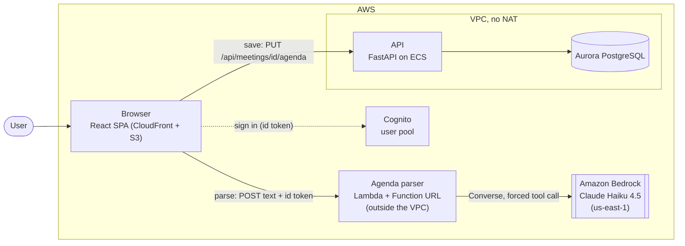

# 0006. Parsing pasted agendas with an LLM outside the VPC

Status: accepted

## Context

Users paste an email, chat message or notes, and Spry should turn it into an agenda form
(topics, owners, minutes, action items with due dates). The original Spry had no agenda at all.

Constraints:

- **No NAT gateway.** The API and Aurora live in private subnets. A NAT gateway costs more than
  the whole feature, so nothing in the VPC can reach the internet.
- **Cost.** The account is on the Free plan with a $5 monthly budget alarm. A VPC interface
  endpoint for Bedrock costs $7.30 per month per endpoint, before the first token.
- **Text from outside.** The pasted text is untrusted. It can contain instructions aimed at the
  model (prompt injection). Whatever reads it must not be able to hurt anything that matters.
- **Model access.** Claude Opus 5.5 is not available for this account (the instructor allowed
  another model). Access checks passed for Claude Haiku 4.5, Claude Sonnet 4.5 and Amazon Nova.

## Decision

**Model.** Claude Haiku 4.5 on Amazon Bedrock
(`us.anthropic.claude-haiku-4-5-20251001-v1:0`), Claude Sonnet 4.5 as the comparison model.
We call the Bedrock Converse API with a forced tool call (`toolChoice` on `record_agenda`).
The tool schema is the Pydantic model `ParsedAgenda`, so the answer is structured JSON, and the
interface does not change if we swap the model.

**Parser outside the VPC.** The parser is a plain function (`backend/app/ai/agenda.py`) wrapped
by one Lambda (`demo-agenda-parser`) with a Function URL. The Lambda is not attached to the VPC,
so it reaches Bedrock over the public AWS endpoint and needs neither NAT nor a VPC endpoint.
The function verifies the Cognito id token itself (signature, issuer, audience, `token_use`),
limits the text to 10,000 characters, and returns JSON.

**The model writes nothing.** The Lambda has no database access and no network path to Aurora.
Its IAM role allows `bedrock:InvokeModel` on two resources only (the Haiku and Sonnet inference
profiles and foundation models) and writing its own logs. The result is a suggestion shown in a
form. The user checks and corrects it, and only then the browser calls the normal authenticated
`PUT /api/meetings/{id}/agenda`, which validates the data again (`extra="forbid"`, length
limits). The raw suggestion is stored next to the saved agenda in `ai_suggestion` (model,
prompt version, what the model proposed).

**Guard rails in the parser.** An `is_agenda` flag lets the model say "this is not an agenda";
`starts_at` must be ISO 8601 and not in the past; relative dates are looked up in a calendar we
put in the prompt, not calculated by the model. A failed check is shown to the model once (one
retry), then the request ends with 422.

**Function URL instead of API Gateway.** One less service to configure and pay for, and the
function already has to validate the JWT. The URL itself is public (`AuthType NONE`), so
unauthenticated calls are rejected with 401 before any Bedrock call and cost nothing in tokens.

### C4, level 2 (containers)

The two flows never meet: parse goes browser → parser → Bedrock and writes nothing; save goes
browser → API → Aurora and happens only after the user reviewed the form.

## Alternatives considered

1. **Bedrock called from the API through a VPC endpoint.** The text would be handled by the
   service that holds the database credentials, so an injected instruction would run next to
   something worth attacking. It also needs an interface endpoint at $7.30 per month (one AZ),
   which is about as much as all the tokens for the expected load. Rejected: bigger blast
   radius and roughly double the monthly cost.
2. **Claude API directly instead of Bedrock.** It needs an API key to store and rotate, sends
   user text to a second vendor outside our AWS account, and bills outside the AWS credits and
   budget alarm. From outside the VPC it would work, but it adds a secret and a vendor for no
   benefit here. Rejected. Bedrock gives IAM access, one bill and one log group.
3. **A regex parser.** No model cost and no latency, but it cannot read free text in two
   languages, cover greetings and signatures, or resolve relative dates such as "next Tuesday"
   and "by end of week". It would break on the first input that does not match the template.
   Rejected. A regex pre-check remains possible later to reject obvious non-agendas before
   spending tokens.

## Consequences

- **Cost of one parse.** On agenda-v5 with Haiku 4.5, the four real agenda inputs cost $0.0029
  to $0.0034 each (average about $0.0032). Sonnet 4.5 costs about $0.0088, roughly three times
  more, and is 2 to 3 times slower. For 20 organisations with 30 agendas per week (about 2,600
  parses per month) Haiku costs about $8.30 per month. The Lambda itself fits in the free tier.
  A VPC endpoint would have added a fixed $7.30.
- **What is logged.** One JSON line per successful parse (`agenda_parsed`): user id (`sub`),
  model, prompt version, input and output tokens, latency in ms, cost in USD. The pasted text
  is not logged.
- **When Bedrock is down or throttled.** The parser answers 429 or 502 and the form shows a
  clear message. The user types the agenda by hand and saves it as usual. Meetings, saving and
  the rest of Spry do not depend on the parser, so they keep working.
- **Known limits.** Any signed-in user can call the parser, and there is no per-user rate limit
  yet, only Bedrock throttling and the 10,000 character cap. The past-date check rejects notes
  about a meeting that already happened (422). Output quality depends on the prompt, so every
  saved agenda stores `prompt_version` to allow comparing versions later.
